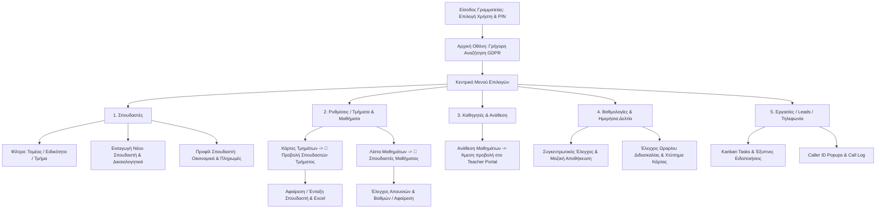

# 🏛️ ΕΓΧΕΙΡΙΔΙΟ ΧΡΗΣΗΣ ΣΥΣΤΗΜΑΤΟΣ ΓΡΑΜΜΑΤΕΙΑΣ (ISAEK CMS)
### Ολοκληρωμένο Πληροφοριακό Σύστημα Διοίκησης & Διαχείρισης Εκπαιδευτηρίου
**ΙΣΑΕΚ Επιμελητηρίου Ηρακλείου**

---

> **Προς τον χρήστη / Εργαλείο AI (Prompt μετατροπής σε PDF):**  
> Το παρόν αρχείο αποτελεί το επίσημο αναλυτικό εγχειρίδιο διαχείρισης του ISAEK CMS. Είναι δομημένο σε μορφή GitHub Flavored Markdown με αυστηρή ιεραρχία τίτλων, αναλυτικούς πίνακες πεδίων, διαγράμματα ροής εργασιών (Mermaid) και ειδικά πλαίσια οδηγιών (Callouts/Alerts). Μετατρέπεται απευθείας σε επαγγελματικό έγγραφο PDF μέσω εργαλείων AI ή Markdown-to-PDF converters.

---

## 📑 ΠΙΝΑΚΑΣ ΠΕΡΙΕΧΟΜΕΝΩΝ

1. [Εισαγωγή & Αρχιτεκτονική του ISAEK CMS](#1-εισαγωγή--αρχιτεκτονική-του-isaek-cms)
2. [Είσοδος στο Σύστημα & Ασφάλεια Συνεδρίας](#2-είσοδος-στο-σύστημα--ασφάλεια-συνεδρίας)
3. [Περιβάλλον Εργασίας & Αρχική Οθόνη Γρήγορης Αναζήτησης](#3-περιβάλλον-εργασίας--αρχική-οθόνη-γρήγορης-αναζήτησης)
4. [Διαχείριση Σπουδαστών (Students Management)](#4-διαχείριση-σπουδαστών-students-management)
   - 4.1 [Προβολή, Φίλτρα Τομέα / Ειδικότητας / Τμήματος & Αναζήτηση](#41-προβολή-φίλτρα-τομέα--ειδικότητας--τμήματος--αναζήτηση)
   - 4.2 [Εισαγωγή Νέου Σπουδαστή (Φόρμα & Δικαιολογητικά)](#42-εισαγωγή-νέου-σπουδαστή-φόρμα--δικαιολογητικά)
   - 4.3 [Πλήρης Φάκελος & Καρτέλα Σπουδαστή](#43-πλήρης-φάκελος--καρτέλα-σπουδαστή)
   - 4.4 [Οικονομική Παρακολούθηση & Καταχώριση Πληρωμών](#44-οικονομική-παρακολούθηση--καταχώριση-πληρωμών)
   - 4.5 [Απόφοιτοι ΒΕΚ & Διαγραφές](#45-απόφοιτοι-βεκ--διαγραφές)
5. [Διαχείριση Ειδικοτήτων, Μαθημάτων & Τμημάτων](#5-διαχείριση-ειδικοτήτων-μαθημάτων--τμημάτων)
   - 5.1 [Ειδικότητες & Τομείς](#51-ειδικότητες--τομείς)
   - 5.2 [Μαθήματα ανά Εξάμηνο & Διαχείριση Σπουδαστών Μαθήματος](#52-μαθήματα-ανά-εξάμηνο--διαχείριση-σπουδαστών-μαθήματος)
   - 5.3 [Ενεργά Τμήματα, Κατανομή & Αφαίρεση Σπουδαστών](#53-ενεργά-τμήματα-κατανομή--αφαίρεση-σπουδαστών)
6. [Μητρώο Καθηγητών & Ανάθεση Μαθημάτων](#6-μητρώο-καθηγητών--ανάθεση-μαθημάτων)
7. [Κεντρικός Έλεγχος Βαθμολογιών (Admin Grades)](#7-κεντρικός-έλεγχος-βαθμολογιών-admin-grades)
8. [Παρακολούθηση Ημερήσιων Δελτίων Διδασκαλίας (Teacher Reports)](#8-παρακολούθηση-ημερήσιων-δελτίων-διδασκαλίας-teacher-reports)
9. [Εκδηλώσεις Ενδιαφέροντος & Υποψήφιοι (Leads)](#9-εκδηλώσεις-ενδιαφέροντος--υποψήφιοι-leads)
10. [Οργάνωση Εργασιών Γραμματείας (Kanban Task Board)](#10-οργάνωση-εργασιών-γραμματείας-kanban-task-board)
11. [Ακαδημαϊκό Ημερολόγιο & Πρόγραμμα](#11-ακαδημαϊκό-ημερολόγιο--πρόγραμμα)
12. [Τηλεφωνία & Αυτόματη Αναγνώριση Κλήσεων (Caller ID)](#12-τηλεφωνία--αυτόματη-αναγνώριση-κλήσεων-caller-id)
13. [Ιστορικό Ενεργειών & Ασφάλεια (Audit Log)](#13-ιστορικό-ενεργειών--ασφάλεια-audit-log)
14. [Συνοπτικό Διάγραμμα Ροών Γραμματείας](#14-συνοπτικό-διάγραμμα-ροών-γραμματείας)
15. [Οδηγός Αντιμετώπισης Προβλημάτων (Troubleshooting)](#15-οδηγός-αντιμετώπισης-προβλημάτων-troubleshooting)

---

## 1. Εισαγωγή & Αρχιτεκτονική του ISAEK CMS

Το **ISAEK CMS** είναι μια εφαρμογή επιπέδου Desktop/Enterprise Web App, ειδικά κατασκευασμένη για να καλύπτει το 100% των διοικητικών, εκπαιδευτικών και οικονομικών αναγκών του ΙΣΑΕΚ Επιμελητηρίου Ηρακλείου.

### Κύρια Χαρακτηριστικά Αρχιτεκτονικής:
* **Cloud Βάση Δεδομένων (Supabase PostgreSQL)**: Ασφαλής και αξιόπιστη αποθήκευση δεδομένων με κρυπτογράφηση.
* **Συγχρονισμός σε Πραγματικό Χρόνο (Real-Time Subscriptions)**: Οποιεσδήποτε βαθμολογίες ή απουσίες καταχωρούνται από τους καθηγητές στην Πύλη τους, εμφανίζονται άμεσα στη Γραμματεία χωρίς απαίτηση ανανέωσης της σελίδας (Refresh).
* **Προστασία Προσωπικών Δεδομένων (GDPR Compliant)**: Έναρξη με οθόνη αναζήτησης ώστε να μην εκτίθενται ονόματα σπουδαστών σε τρίτους που βρίσκονται μπροστά από την οθόνη της Γραμματείας.
* **Αποθήκευση Ψηφιοποιημένων Εγγράφων**: Πλήρης ψηφιοποίηση δικαιολογητικών σπουδαστών (ταυτότητες, απολυτήρια, βεβαιώσεις) με δυνατότητα άμεσης προβολής και λήψης.

---

## 2. Είσοδος στο Σύστημα & Ασφάλεια Συνεδρίας

### 2.1 Διαδικασία Σύνδεσης:
1. Ανοίξτε τον browser και μεταβείτε στην κεντρική διεύθυνση του συστήματος.
2. Εμφανίζεται η οθόνη εισόδου **«Γραμματεία ΙΕΚ — Είσοδος στο σύστημα διαχείρισης»**.
3. **Επιλογή Προφίλ Χρήστη**: Επιλέξτε το όνομά σας από τη λίστα των εξουσιοδοτημένων υπαλλήλων της Γραμματείας (π.χ. *Melpo*, *Nikolopoulou* κ.λπ.).
4. **Κωδικός Πρόσβασης (PIN)**: Πληκτρολογήστε τον ασφαλή κωδικό πρόσβασης της Γραμματείας.
5. Πατήστε **«Είσοδος ➔»**.

> [!NOTE]
> Το σύστημα διατηρεί τη σύνδεσή σας ενεργή στον συγκεκριμένο υπολογιστή. Εάν επιθυμείτε να αποχωρήσετε, συνιστάται να πατήσετε **«Αποσύνδεση»** από το μενού για την προστασία των δεδομένων.

---

## 3. Περιβάλλον Εργασίας & Αρχική Οθόνη Γρήγορης Αναζήτησης

Κατά την εκκίνηση, το σύστημα ανοίγει στην **Αρχική Οθόνη Αναζήτησης (Start Screen)**.

### 3.1 Γιατί υπάρχει η Αρχική Οθόνη;
Προστατεύει τα προσωπικά δεδομένα των σπουδαστών από αδιάκριτα βλέμματα στον χώρο υποδοχής της Γραμματείας. Αντί να προβάλλεται αυτόματα όλη η λίστα μαθητών, παρέχεται ένα κεντρικό πεδίο αναζήτησης:
* Πληκτρολογήστε **Ονοματεπώνυμο**, **Τηλέφωνο**, **ΑΜΚΑ**, **ΑΦΜ** ή **Αριθμό Ταυτότητας**.
* Πατήστε **Enter** ή το κουμπί **«Αναζήτηση»**.
* Το σύστημα μεταβαίνει αμέσως στον πίνακα σπουδαστών προβάλλοντας τα σχετικά αποτελέσματα.

### 3.2 Πλοήγηση (Desktop Menubar & Sidebar)
* **Επάνω Γραμμή Μενού (Menubar)**:
  * *Αρχική (Αναζήτηση)*: Επιστροφή στην αρχική οθόνη.
  * *Σπουδαστές*: Προβολή ενεργών σπουδαστών.
  * *Απόφοιτοι ΒΕΚ*: Σπουδαστές που έχουν ολοκληρώσει τη φοίτηση.
  * *Διαγραφέντες*: Σπουδαστές που έχουν διαγραφεί.
  * *Καθηγητές*: Μητρώο εκπαιδευτικών & αναθέσεις.
  * *Βαθμολογίες*: Συγκεντρωτικός πίνακας βαθμών.
  * *Ημερήσια Δελτία*: Έλεγχος ωρών & παρουσιών καθηγητών.
  * *Ενδιαφέροντα*: Υποψήφιοι νέοι σπουδαστές (Leads).
  * *Εργασίες*: Πίνακας εκκρεμοτήτων (Kanban).
  * *Ημερολόγιο*: Ακαδημαϊκό πρόγραμμα.
  * *Επαφές*: Εξωτερικοί συνεργάτες / προμηθευτές.
  * *Ρυθμίσεις*: Διαχείριση Ειδικοτήτων, Μαθημάτων, Τμημάτων και Τομέων.
  * *Ιστορικό*: Audit Log καταγραφής ενεργειών.

---

## 4. Διαχείριση Σπουδαστών (Students Management)

### 4.1 Προβολή, Φίλτρα & Αναζήτηση
Στην επάνω γραμμή εργαλείων (Toolbar) υπάρχουν δυναμικά φίλτρα:
1. **Πεδίο Αναζήτησης**: Αναζητά άμεσα σε πραγματικό χρόνο με ελληνικούς χαρακτήρες (ανεξαρτήτως τόνων ή κεφαλαίων/πεζών).
2. **Φίλτρο Ειδικότητας**: Περιορίζει την προβολή στους σπουδαστές συγκεκριμένης ειδικότητας.
3. **Φίλτρο Τμήματος**: Επιτρέπει την απομόνωση ενός συγκεκριμένου τμήματος (π.χ. *Α1*, *Α2*, *Β1*).
4. **Κουμπί «Εμφάνιση/Απόκρυψη Στατιστικών»**: Εμφανίζει γραφήματα και συνολικούς δείκτες.
5. **Κουμπί «+ Εισαγωγή Σπουδαστή»**: Άνοιγμα της φόρμας εγγραφής.

---

### 4.2 Εισαγωγή Νέου Σπουδαστή (Φόρμα & Δικαιολογητικά)

Πατώντας **«Εισαγωγή Σπουδαστή»**, ανοίγει η αναλυτική καρτέλα εγγραφής:

| Ενότητα Φόρμας | Περιλαμβανόμενα Πεδία | Σημασία & Παρατηρήσεις |
| :--- | :--- | :--- |
| **Προσωπικά Στοιχεία** | Ονοματεπώνυμο, Πατρώνυμο, Μητρώνυμο, Ημ. Γέννησης, Φύλο | Υποχρεωτικά στοιχεία ταυτοποίησης |
| **Στοιχεία Ταυτότητας** | Αριθμός Ταυτότητας / Διαβατηρίου, ΑΜΚΑ, ΑΦΜ, ΔΟΥ | Απαραίτητα για την επίσημη δήλωση στο Υπουργείο |
| **Επικοινωνία** | Κινητό Τηλέφωνο, Σταθερό, Email, Διεύθυνση, Τ.Κ., Πόλη | Σύνδεση με το σύστημα Caller ID |
| **Εκπαιδευτικά Στοιχεία** | Τομέας, Ειδικότητα, Τμήμα, Εξάμηνο Φοίτησης, Αρ. Μητρώου (Α.Μ.) | Καθορίζει τα μαθήματα και το τμήμα του σπουδαστή |
| **Οικονομικά Στοιχεία** | Συνολικά Δίδακτρα (€), Προκαταβολή (€), Τρόπος Πληρωμής | Δημιουργεί αυτόματα το οικονομικό πλάνο |
| **Δικαιολογητικά** | Μεταφόρτωση αρχείων (PDF, Εικόνες) | Αποθήκευση τίτλων σπουδών, ταυτότητας κ.λπ. |

> [!TIP]
> Μπορείτε να σύρετε (drag & drop) πολλαπλά αρχεία δικαιολογητικών απευθείας στη φόρμα. Τα αρχεία κρυπτογραφούνται και συνδέονται μόνιμα με το προφίλ του σπουδαστή.

---

### 4.3 Πλήρης Φάκελος & Καρτέλα Σπουδαστή
Κάνοντας διπλό κλικ σε οποιονδήποτε σπουδαστή (ή πατώντας το εικονίδιο προβολής), ανοίγει το **Student Profile Modal**:
* **Καρτέλα «Γενικά»**: Πλήρη ατομικά, οικογενειακά και επικοινωνιακά στοιχεία.
* **Καρτέλα «Οικονομικά»**: Αναλυτική καρτέλα οφειλών, ιστορικό πληρωμών με ημερομηνία και απόδειξη, κουμπί καταχώρισης νέας είσπραξης.
* **Καρτέλα «Βαθμολογίες»**: Όλοι οι βαθμοί του σπουδαστή ανά μάθημα και εξάμηνο.
* **Καρτέλα «Απουσίες»**: Αναλυτικό απουσιολόγιο με ημερομηνίες και ώρες.
* **Καρτέλα «Έγγραφα»**: Προβολή και άμεσο κατέβασμα των επισυναπτόμενων δικαιολογητικών.

---

### 4.4 Οικονομική Παρακολούθηση & Καταχώριση Πληρωμών
* Σε κάθε σπουδαστή καταγράφονται: **Συνολικό Κόστος**, **Καταβεβλημένα** και **Υπόλοιπο Οφειλής**.
* **Καταχώριση Είσπραξης**:
  1. Ανοίξτε την καρτέλα του σπουδαστή.
  2. Μεταβείτε στα **«Οικονομικά»**.
  3. Εισάγετε το ποσό που εισπράχθηκε και τον τρόπο πληρωμής (Μετρητά, POS, Τραπεζική Κατάθεση).
  4. Πατήστε **«Καταχώριση Πληρωμής»**. Το υπόλοιπο αναπροσαρμόζεται αυτόματα.
* Στο κάτω μέρος της εφαρμογής (Statusbar) εμφανίζεται ανά πάσα στιγμή το **Σύνολο Ανεξόφλητων Οφειλών** για όλους τους φιλτραρισμένους σπουδαστές.

---

### 4.5 Απόφοιτοι ΒΕΚ & Διαγραφές
* **Απόφοιτος ΒΕΚ**: Όταν ένας σπουδαστής ολοκληρώσει τις σπουδές του, αλλάζετε την κατάστασή του σε `Απόφοιτος ΒΕΚ`. Μεταφέρεται αυτόματα στην αντίστοιχη καρτέλα του μενού χωρίς να διαγραφεί το ιστορικό του.
* **Διαγραφή**: Για σπουδαστές που διέκοψαν, η κατάσταση τίθεται σε `Διαγραφείς`.
* **Οριστική Διαγραφή**: Πραγματοποιείται μόνο σε περιπτώσεις λανθασμένης καταχώρισης, με διπλή επιβεβαίωση.

---

## 5. Διαχείριση Ειδικοτήτων, Μαθημάτων & Τμημάτων

Από το μενού **«Ρυθμίσεις»**, έχετε πλήρη έλεγχο της ακαδημαϊκής δομής:

### 5.1 Ειδικότητες & Τομείς
* Δημιουργία νέων ειδικοτήτων με τίτλο και υπαγωγή σε Τομέα.
* Επεξεργασία και αρχειοθέτηση.

---

### 5.2 Μαθήματα ανά Εξάμηνο & Διαχείριση Σπουδαστών Μαθήματος
Στην καρτέλα **«Μαθήματα»**, επιλέγετε την ειδικότητα και βλέπετε τα μαθήματα χωρισμένα σε **Εξάμηνο Α, Β, Γ, Δ**.

#### 👥 ΝΕΑ ΛΕΙΤΟΥΡΓΙΑ: Κουμπί «Σπουδαστές» ανά Μάθημα:
Δίπλα σε κάθε μάθημα υπάρχει το κουμπί **«👥 Σπουδαστές»**. Πατώντας το:
1. Ανοίγει το παράθυρο **«Σπουδαστές Μαθήματος»**.
2. Βλέπετε όλους τους σπουδαστές που παρακολουθούν το μάθημα.
3. Μπορείτε να φιλτράρετε ανά **Τμήμα** (π.χ. *Α1*, *Α2*).
4. Εμφανίζονται για κάθε σπουδαστή: **Ώρες Απουσιών**, **Βαθμός Προόδου (20%)**, **Τελικός Βαθμός (80%)** και **Μέσος Όρος**.
5. **❌ Αφαίρεση από Μάθημα**: Πατώντας το κουμπί αφαίρεσης, διαγράφονται οι βαθμοί και οι απουσίες του σπουδαστή για το συγκεκριμένο μάθημα, αποδεσμεύοντάς τον.
6. **📥 Εξαγωγή Excel**: Λήψη πλήρους βαθμολογίου του μαθήματος σε αρχείο `.xlsx`.

---

### 5.3 Ενεργά Τμήματα, Κατανομή & Αφαίρεση Σπουδαστών
Στην καρτέλα **«Τμήματα»**, βλέπετε όλα τα ενεργά τμήματα του ΙΣΑΕΚ σε μορφή καρτών.

#### 👥 ΝΕΑ ΛΕΙΤΟΥΡΓΙΑ: Πλήθος & Κουμπί «Προβολή Σπουδαστών»:
* Κάθε κάρτα τμήματος αναγράφει το ακριβές πλήθος μαθητών (π.χ. `👥 22 σπουδαστές`).
* Πατώντας **«Προβολή Σπουδαστών (Χ)»**, ανοίγει το εξειδικευμένο παράθυρο διαχείρισης τμήματος:
  * **Αναζήτηση**: Άμεσο φιλτράρισμα μαθητών μέσα στο τμήμα.
  * **Στοιχεία Επικοινωνίας**: Α.Μ., Ονοματεπώνυμο, Τηλέφωνο (με δυνατότητα άμεσης κλήσης), Email.
  * **❌ Αφαίρεση από Τμήμα**: Αποσυνδέει τον μαθητή από το τμήμα με ένα κλικ (ενημερώνει τη βάση δεδομένων και καταγράφει την κίνηση στο Audit Log).
  * **➕ Ένταξη Σπουδαστή**: Επιλέξτε οποιονδήποτε άλλο σπουδαστή της ειδικότητας από το dropdown για να τον εντάξετε άμεσα στο τμήμα.
  * **📥 Εξαγωγή Excel**: Κατεβάζει επίσημη ονομαστική κατάσταση τμήματος.
  * **🗑️ Διαγραφή Σπουδαστή**: Δυνατότητα πλήρους διαγραφής αν χρειαστεί.

---

## 6. Μητρώο Καθηγητών & Ανάθεση Μαθημάτων

Στην ενότητα **«Καθηγητές»**:
1. Διατηρείτε πλήρη κατάλογο των καθηγητών με τηλέφωνα, email και ειδικότητα.
2. **Ανάθεση Μαθημάτων**:
   * Επιλέγετε τον καθηγητή και πατάτε **«Ανάθεση Μαθημάτων»**.
   * Επιλέγετε την Ειδικότητα και τσεκάρετε τα μαθήματα που του ανατίθενται.
   * **Άμεσο Αποτέλεσμα**: Ο καθηγητής, όταν συνδεθεί στην Πύλη Καθηγητών, βλέπει αυτόματα μόνο τα μαθήματα που του αναθέσατε!

---

## 7. Κεντρικός Έλεγχος Βαθμολογιών (Admin Grades)

Από την επιλογή **«Βαθμολογίες»** του κεντρικού μενού:
* Έχετε πανοραμική εικόνα όλων των βαθμολογιών του ΙΣΑΕΚ.
* Φιλτράρετε ανά Ειδικότητα, Εξάμηνο, Μάθημα και Τμήμα.
* Μπορείτε να καταχωρίσετε ή να διορθώσετε βαθμούς απευθείας από τη Γραμματεία.
* Εξάγετε συγκεντρωτικά βαθμολόγια για το αρχείο του εκπαιδευτηρίου.

---

## 8. Παρακολούθηση Ημερήσιων Δελτίων Διδασκαλίας (Teacher Reports)

Από την επιλογή **«Ημερήσια Δελτία»**:
* Παρακολουθείτε ζωντανά τις αναφορές που υποβάλλουν οι καθηγητές από τις αίθουσες διδασκαλίας.
* Ελέγχετε τις ώρες άφιξης και αναχώρησης (ψηφιακό χτύπημα κάρτας).
* Βλέπετε συγκεντρωτικά ποιες ώρες πραγματοποιήθηκαν και ποιες απουσίες σημειώθηκαν.

---

## 9. Εκδηλώσεις Ενδιαφέροντος & Υποψήφιοι (Leads)

Στην ενότητα **«Ενδιαφέροντα»**:
* Καταχωρούνται υποψήφιοι σπουδαστές που επικοινώνησαν τηλεφωνικά ή μέσω της ιστοσελίδας.
* Καταγράφεται η ειδικότητα που τους ενδιαφέρει, σημειώσεις επικοινωνίας και ημερομηνία επόμενης κλήσης.
* **Μαγικό Κουμπί «Μετατροπή σε Σπουδαστή»**: Μόλις ο υποψήφιος εγγραφεί, πατάτε μετατροπή και τα στοιχεία του μεταφέρονται αυτόματα στο επίσημο Μητρώο Σπουδαστών χωρίς να χρειάζεται επαναπληκτρολόγηση!

---

## 10. Οργάνωση Εργασιών Γραμματείας (Kanban Task Board)

Στην ενότητα **«Εργασίες»**:
* Ψηφιακός πίνακας Kanban με στήλες: **Εκκρεμεί**, **Σε εξέλιξη**, **Ολοκληρώθηκε**.
* Δυνατότητα ανάθεσης σε συγκεκριμένο υπάλληλο και ορισμός ημερομηνίας λήξης (Due Date).
* **Έξυπνες Ειδοποιήσεις (Smart Alerts)**: Το σύστημα ειδοποιεί αυτόματα για εργασίες που λήγουν σήμερα ή είναι εκπρόθεσμες.

---

## 11. Ακαδημαϊκό Ημερολόγιο & Πρόγραμμα

Στην ενότητα **«Ημερολόγιο»**:
* Προβολή σε μορφή Μήνα, Εβδομάδας, Ημέρας και Ατζέντας.
* Καταγραφή αργιών, εξεταστικών περιόδων, εκδηλώσεων και συναντήσεων καθηγητών.

---

## 12. Τηλεφωνία & Αυτόματη Αναγνώριση Κλήσεων (Caller ID)

Το ISAEK CMS διαθέτει ενσωματωμένη διασύνδεση με το τηλεφωνικό κέντρο:
* Όταν χτυπάει το τηλέφωνο, εμφανίζεται αυτόματα αναδυόμενο παράθυρο (**Caller ID Popup**).
* Το σύστημα αναγνωρίζει αν ο καλών είναι σπουδαστής, γονέας ή καθηγητής και εμφανίζει άμεσα το ονοματεπώνυμό του, την ειδικότητά του και το τρέχον υπόλοιπο οφειλής του.
* Παρέχεται κουμπί για άμεσο άνοιγμα της καρτέλας του και καταγραφή σημείωσης κλήσης στο αρχείο καταγραφής (**Call Log**).

---

## 13. Ιστορικό Ενεργειών & Ασφάλεια (Audit Log)

Στην ενότητα **«Ιστορικό»**:
* Καταγράφεται αυτόματα κάθε κρίσιμη ενέργεια:
  * Ποιος χρήστης έκανε την ενέργεια.
  * Τι είδους ενέργεια ήταν (INSERT, UPDATE, DELETE).
  * Σε ποια εγγραφή αφορούσε (π.χ. *Αφαίρεση σπουδαστή από το Τμήμα Α1*).
  * Ακριβής χρονοσφραγίδα (Ημερομηνία & Ώρα).
* Εξασφαλίζει πλήρη διαφάνεια και δυνατότητα ελέγχου σε περίπτωση λάθους.

---

## 14. Συνοπτικό Διάγραμμα Ροών Γραμματείας

---

## 15. Οδηγός Αντιμετώπισης Προβλημάτων (Troubleshooting)

### Πρόβλημα 1: Πώς αλλάζω έναν σπουδαστή από το Τμήμα Α1 στο Τμήμα Α2;
1. Μεταβείτε στις **«Ρυθμίσεις» ➔ «Τμήματα»**.
2. Στην κάρτα του Τμήματος Α1, πατήστε **«Προβολή Σπουδαστών»**.
3. Εντοπίστε τον σπουδαστή και πατήστε **«❌ Αφαίρεση από Τμήμα»**.
4. Κλείστε το παράθυρο και ανοίξτε την κάρτα του Τμήματος Α2 πατώντας **«Προβολή Σπουδαστών»**.
5. Στο επάνω μέρος, επιλέξτε τον σπουδαστή από το μενού **«Ένταξη Σπουδαστή»** και πατήστε **«+ Ένταξη»**.

### Πρόβλημα 2: Ένας καθηγητής δεν βλέπει το μάθημα στην Πύλη του. Τι κάνω;
1. Μεταβείτε στο μενού **«Καθηγητές»**.
2. Βρείτε τον καθηγητή και πατήστε **«Ανάθεση Μαθημάτων»**.
3. Επιλέξτε την Ειδικότητα και τσεκάρετε το αντίστοιχο μάθημα.
4. Πατήστε **«Αποθήκευση»**. Ο καθηγητής θα δει το μάθημα αμέσως στην οθόνη του χωρίς να χρειαστεί επανεκκίνηση.

### Πρόβλημα 3: Πώς εξάγω τα στοιχεία σε Excel;
Σε όλες τις κεντρικές προβολές (Σπουδαστές, Τμήματα, Μαθήματα, Βαθμολογίες) υπάρχει ειδικό πράσινο κουμπί **«📥 Εξαγωγή Excel»**. Πατώντας το, κατεβαίνει αμέσως στον υπολογιστή σας αρχείο `.xlsx` πλήρως μορφοποιημένο.

---
*Τέλος Εγχειριδίου Γραμματείας — ISAEK CMS — Επιμελητήριο Ηρακλείου*
