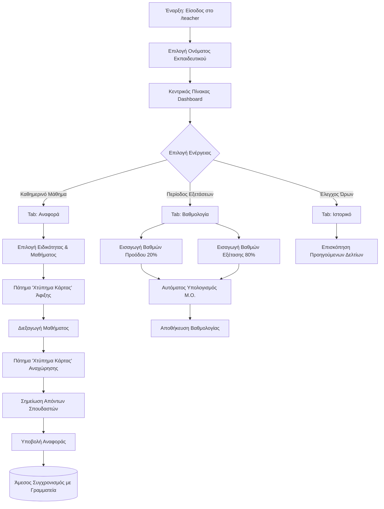

# 📘 ΕΓΧΕΙΡΙΔΙΟ ΧΡΗΣΗΣ ΠΥΛΗΣ ΚΑΘΗΓΗΤΩΝ (TEACHER PORTAL)
### ΙΣΑΕΚ Επιμελητηρίου Ηρακλείου — Ολοκληρωμένο Σύστημα Διαχείρισης Εκπαιδευτών

---

> **Προς τον χρήστη / Εργαλείο AI (Prompt μετατροπής σε PDF):**  
> Το παρόν αρχείο είναι γραμμένο σε αυστηρή, δομημένη μορφή Markdown. Χρησιμοποιήστε το σε εργαλεία μετατροπής Markdown σε PDF (π.χ. ChatGPT, Claude, Marp, Notion, Pandoc ή Typora). Παράγει αυτόματα επίσημο, πολυτελές εγχειρίδιο χρήσης (User Manual) με εξώφυλλο, πίνακα περιεχομένων, πίνακες πεδίων, διαγράμματα ροής και αναλυτικές επεξηγήσεις.

---

## 📑 ΠΙΝΑΚΑΣ ΠΕΡΙΕΧΟΜΕΝΩΝ

1. [Εισαγωγή & Σκοπός της Πύλης](#1-εισαγωγή--σκοπός-της-πύλης)
2. [Πρόσβαση & Σύνδεση Εκπαιδευτικού](#2-πρόσβαση--σύνδεση-εκπαιδευτικού)
3. [Κεντρικός Πίνακας Ελέγχου (Dashboard)](#3-κεντρικός-πίνακας-ελέγχου-dashboard)
4. [Ημερήσιο Δελτίο Διδασκαλίας & Απουσιολόγιο (Tab «Αναφορά»)](#4-ημερήσιο-δελτίο-διδασκαλίας--απουσιολόγιο-tab-αναφορά)
   - 4.1 [Ψηφιακό «Χτύπημα Κάρτας» (Άφιξη / Αναχώρηση)](#41-ψηφιακό-χτύπημα-κάρτας-άφιξη--αναχώρηση)
   - 4.2 [Καταχώριση Απουσιών Σπουδαστών](#42-καταχώριση-απουσιών-σπουδαστών)
   - 4.3 [Υποβολή & Καθαρισμός Φόρμας](#43-υποβολή--καθαρισμός-φόρμας)
5. [Καταχώριση & Έλεγχος Βαθμολογιών (Tab «Βαθμολογία»)](#5-καταχώριση--έλεγχος-βαθμολογιών-tab-βαθμολογία)
   - 5.1 [Τύπος Υπολογισμού Τελικού Βαθμού](#51-τύπος-υπολογισμού-τελικού-βαθμού)
   - 5.2 [Αποθήκευση & Οριστικοποίηση](#52-αποθήκευση--οριστικοποίηση)
6. [Ιστορικό Υποβληθεισών Αναφορών (Tab «Ιστορικό»)](#6-ιστορικό-υποβληθεισών-αναφορών-tab-ιστορικό)
7. [Διάγραμμα Ροής Εργασιών Καθηγητή (Workflow)](#7-διάγραμμα-ροής-εργασιών-καθηγητή-workflow)
8. [Συχνές Ερωτήσεις & Επίλυση Προβλημάτων (FAQ)](#8-συχνές-ερωτήσεις--επίλυση-προβλημάτων-faq)

---

## 1. Εισαγωγή & Σκοπός της Πύλης

Η **Πύλη Καθηγητών (Teacher Portal)** αποτελεί ένα σύγχρονο, εύχρηστο και ασφαλές ψηφιακό περιβάλλον, ειδικά σχεδιασμένο για το εκπαιδευτικό προσωπικό του ΙΣΑΕΚ Επιμελητηρίου Ηρακλείου.

### Βασικοί Στόχοι της Πύλης:
* **Κατάργηση των χειρόγραφων εντύπων**: Άμεση καταγραφή ωρών διδασκαλίας και απουσιών από υπολογιστή, tablet ή κινητό τηλέφωνο.
* **Ψηφιακό Ωρολόγιο (Χτύπημα Κάρτας)**: Αυτόματη και αδιάβλητη καταγραφή της ώρας έναρξης και λήξης του μαθήματος με ένα κλικ.
* **Ηλεκτρονικό Βαθμολόγιο**: Καταχώριση βαθμών προόδου και τελικής εξέτασης με αυτόματο υπολογισμό του τελικού μέσου όρου.
* **Άμεση Ενημέρωση Γραμματείας**: Όλα τα δεδομένα συγχρονίζονται σε πραγματικό χρόνο (Real-Time Cloud Sync) με το κεντρικό σύστημα της Γραμματείας.

---

## 2. Πρόσβαση & Σύνδεση Εκπαιδευτικού

### 2.1 Διεύθυνση Εισόδου (URL)
Για να μεταβείτε στην Πύλη Καθηγητών, πληκτρολογήστε στη γραμμή διευθύνσεων του browser:
```text
https://isaek.example.com/teacher
(ή επιλέξτε «Πύλη Καθηγητών» από την αρχική σελίδα εισόδου)
```

### 2.2 Βήματα Σύνδεσης:
1. Στην οθόνη υποδοχής, εμφανίζεται το πεδίο **«Επιλογή Εκπαιδευτικού»**.
2. Πατήστε στο πτυσσόμενο μενού (Dropdown) και **επιλέξτε το ονοματεπώνυμό σας**. Η λίστα είναι ταξινομημένη αλφαβητικά.
3. Πατήστε το πράσινο κουμπί **«Είσοδος ➔»**.
4. Το σύστημα αναγνωρίζει αυτόματα τα μαθήματα και τα τμήματα που σας έχει αναθέσει η Γραμματεία και σας μεταφέρει στην αρχική σας σελίδα.

> [!NOTE]
> Εάν το όνομά σας δεν εμφανίζεται στη λίστα, παρακαλούμε επικοινωνήστε άμεσα με τη Γραμματεία για να επιβεβαιώσει την εγγραφή σας στο μητρώο καθηγητών.

---

## 3. Κεντρικός Πίνακας Ελέγχου (Dashboard)

Μετά τη σύνδεσή σας, βλέπετε την καρτέλα **«Αρχική»**.

### 3.1 Μετρητές & Στατιστικά (KPI Cards)
Στο επάνω μέρος της οθόνης προβάλλονται συνοπτικά:
* 📘 **Μαθήματα**: Ο συνολικός αριθμός των μαθημάτων που διδάσκετε στο τρέχον εξάμηνο.
* 👥 **Μαθητές**: Το σύνολο των εγγεγραμμένων σπουδαστών στις ειδικότητές σας.
* 📝 **Αναφορές**: Το πλήθος των ημερήσιων αναφορών διδασκαλίας που έχετε ήδη υποβάλει.
* 📈 **Ειδικότητες**: Ο αριθμός των διαφορετικών ειδικοτήτων στις οποίες διδάσκετε.

### 3.2 Ενότητα «Τα Μαθήματά Μου»
Εμφανίζονται κάρτες ανά ειδικότητα με αναλυτικές πληροφορίες:
* Τίτλος Ειδικότητας (π.χ. *Τεχνικός Εφαρμογών Πληροφορικής*).
* Πλήθος μαθητών και πλήθος μαθημάτων.
* Λίστα μαθημάτων που σας έχουν ανατεθεί.
* Κουμπί άμεσης ενέργειας: **«📋 Νέα Αναφορά»** (σας μεταφέρει αυτόματα στη φόρμα συμπλήρωσης για τη συγκεκριμένη ειδικότητα).

### 3.3 Πρόσφατες Αναφορές
Στο κάτω μέρος προβάλλονται οι 3 πιο πρόσφατες αναφορές που καταχωρίσατε, με ημερομηνία, μάθημα, ωράριο διδασκαλίας και ένδειξη επιτυχούς υποβολής (`✓ Υποβλήθηκε`).

---

## 4. Ημερήσιο Δελτίο Διδασκαλίας & Απουσιολόγιο (Tab «Αναφορά»)

Η καρτέλα **«Αναφορά»** είναι το βασικό εργαλείο που χρησιμοποιείτε σε κάθε μάθημα.

### 4.1 Ψηφιακό «Χτύπημα Κάρτας» (Άφιξη / Αναχώρηση)

Για τη διασφάλιση της διαφάνειας και της ακρίβειας των ωρών διδασκαλίας, το σύστημα διαθέτει ενσωματωμένο χρονόμετρο:

| Πεδίο Φόρμας | Περιγραφή | Τρόπος Συμπλήρωσης |
| :--- | :--- | :--- |
| **Ειδικότητα** | Η ειδικότητα στην οποία πραγματοποιείται το μάθημα | Επιλογή από dropdown |
| **Μάθημα** | Το διδασκόμενο μάθημα | Επιλογή από dropdown (φιλτραρισμένο) |
| **Ημερομηνία** | Η ημέρα διδασκαλίας | Αυτόματα η σημερινή (τροποποιήσιμη αν χρειαστεί) |
| **Ώρα Άφιξης** | Η ώρα έναρξης της διδασκαλίας | Πατώντας το μπλε κουμπί **«Χτύπημα Κάρτας»** κατά την άφιξή σας |
| **Ώρα Αναχώρησης** | Η ώρα λήξης της διδασκαλίας | Πατώντας το κόκκινο κουμπί **«Χτύπημα Κάρτας»** κατά την αποχώρησή σας |
| **Διάρκεια** | Υπολογισμένη συνολική διάρκεια | Υπολογίζεται **αυτόματα** (π.χ. *3 ώρ. 15 λεπτά*) |

> [!IMPORTANT]
> Τα πεδία ώρας είναι κλειδωμένα (`read-only`) για χειροκίνητη πληκτρολόγηση και ενημερώνονται αποκλειστικά μέσω των πλήκτρων «Χτύπημα Κάρτας», διασφαλίζοντας την εγκυρότητα του ωραρίου.

---

### 4.2 Καταχώριση Απουσιών Σπουδαστών

Μόλις επιλέξετε Ειδικότητα και Μάθημα, εμφανίζεται αμέσως η λίστα όλων των εγγεγραμμένων σπουδαστών:

1. **Επιλογή Απόντα**: Κάνετε κλικ πάνω στο όνομα του σπουδαστή ή στο κουτάκι ελέγχου (checkbox).
2. **Σήμανση**: Ο σπουδαστής κοκκινίζει και λαμβάνει την ένδειξη `Απών/ούσα`.
3. **Ώρες Απουσίας**:
   * Προεπιλεγμένα, καταχωρίζονται οι συνολικές ώρες της διδασκαλίας.
   * Εάν κάποιος σπουδαστής αποχώρησε νωρίτερα ή ήρθε καθυστερημένα, μπορείτε να αλλάξετε τον αριθμό ωρών στο ειδικό πεδίο (π.χ. από 3 σε 1).
4. **Συγκεντρωτική Ένδειξη**: Στην κεφαλίδα της λίστας φαίνεται άμεσα πόσοι σπουδαστές είναι παρόντες και πόσοι απόντες (π.χ. `2 απόντες`).

---

### 4.3 Υποβολή & Καθαρισμός Φόρμας

* **Υποβολή Αναφοράς (Πράσινο κουμπί)**:  
  Πατώντας **«Υποβολή Αναφοράς»**, το σύστημα:
  1. Αποθηκεύει το δελτίο διδασκαλίας στο ιστορικό.
  2. Καταχωρίζει τις απουσίες στις ατομικές καρτέλες των σπουδαστών.
  3. Εμφανίζει πράσινο μήνυμα επιτυχίας: `✓ Η αναφορά υποβλήθηκε επιτυχώς!`.
  4. Αποστέλλει τα στοιχεία άμεσα στο ταμπλό της Γραμματείας.

* **Καθαρισμός (Κόκκινο κουμπί)**:  
  Εάν κάνατε λάθος πριν την υποβολή, πατήστε **«Καθαρισμός»** για να μηδενιστούν τα πεδία και να ξεκινήσετε εκ νέου.

---

## 5. Καταχώριση & Έλεγχος Βαθμολογιών (Tab «Βαθμολογία»)

Στην καρτέλα **«Βαθμολογία»**, καταχωρίζετε τις βαθμολογίες των σπουδαστών σας ανά εξάμηνο.

### 5.1 Διαδικασία Βαθμολόγησης:
1. Επιλέξτε την **Ειδικότητα** και το **Μάθημα**.
2. Εμφανίζεται ο πίνακας όλων των σπουδαστών με τις εξής στήλες:
   * **Σπουδαστής**: Ονοματεπώνυμο.
   * **Εργασία 6μήνου (Πρόοδος)**: Βαθμός με συντελεστή **20%** (κλίμακα 0 - 20).
   * **Τελική Εξέταση**: Βαθμός με συντελεστή **80%** (κλίμακα 0 - 20).
   * **Τελικός Βαθμός**: Υπολογίζεται αυτόματα σε πραγματικό χρόνο!

### 5.2 Τύπος Υπολογισμού Τελικού Βαθμού:
$$\text{Τελικός Βαθμός} = (\text{Βαθμός Προόδου} \times 0.20) + (\text{Βαθμός Εξέτασης} \times 0.80)$$

*Παράδειγμα:*  
Αν ένας σπουδαστής λάβει **16** στην Πρόοδο και **14** στην Τελική Εξέταση:  
$$\text{Τελικός} = (16 \times 0.20) + (14 \times 0.80) = 3.2 + 11.2 = \mathbf{14.4}$$

### 5.3 Αποθήκευση:
Πατήστε το κουμπί **«💾 Αποθήκευση Βαθμολογίας»**. Οι βαθμοί κλειδώνουν με ασφάλεια στη βάση και είναι άμεσα προσβάσιμοι από τη Γραμματεία για την έκδοση αναλυτικών βαθμολογιών και βεβαιώσεων σπουδών.

---

## 6. Ιστορικό Υποβληθεισών Αναφορών (Tab «Ιστορικό»)

Στην καρτέλα **«Ιστορικό»**, έχετε πλήρη έλεγχο όλων των δελτίων που έχετε υποβάλει από την αρχή της εκπαιδευτικής περιόδου:

* **Κάρτες Αναφορών**: Ταξινομημένες χρονολογικά (από τις νεότερες προς τις παλαιότερες).
* **Στοιχεία Κάρτας**:
  * Ημερομηνία διδασκαλίας.
  * Τίτλος Μαθήματος & Ειδικότητα.
  * Ώρες διδασκαλίας (π.χ. *17:00 - 20:15*).
  * Κατάσταση (`✓ Υποβλήθηκε`).
  * Αναλυτική λίστα με τα ονόματα των σπουδαστών που είχαν σημειωθεί ως απόντες.

> [!TIP]
> Χρησιμοποιήστε το Ιστορικό στο τέλος κάθε μήνα για να διασταυρώσετε τις συνολικές δεδουλευμένες ώρες διδασκαλίας σας με το λογιστήριο του ΙΣΑΕΚ.

---

## 7. Διάγραμμα Ροής Εργασιών Καθηγητή (Workflow)



---

## 8. Συχνές Ερωτήσεις & Επίλυση Προβλημάτων (FAQ)

### Ερ. 1: Τι κάνω αν δεν εμφανίζεται κάποιο μάθημα που διδάσκω;
**Απ:** Τα μαθήματα αντιστοιχίζονται στο προφίλ σας από τη Γραμματεία. Εάν λείπει κάποιο μάθημα, ενημερώστε τη Γραμματεία ώστε να σας το προσθέσει μέσω του πίνακα διαχείρισης καθηγητών (`Teacher Directory`). Η αλλαγή εμφανίζεται στην οθόνη σας άμεσα, χωρίς να χρειαστεί επανεκκίνηση.

### Ερ. 2: Ξέχασα να πατήσω «Χτύπημα Κάρτας» κατά την άφιξή μου. Τι να κάνω;
**Απ:** Εάν παραλείψατε να πατήσετε το κουμπί στην έναρξη, πατήστε το μόλις το θυμηθείτε και ενημερώστε τη Γραμματεία ή σημειώστε το στο τέλος του μαθήματος. Η Γραμματεία έχει τη δυνατότητα να διορθώσει την ώρα από το διαχειριστικό της περιβάλλον.

### Ερ. 3: Μπορώ να χρησιμοποιήσω την Πύλη από το κινητό μου τηλέφωνο (Smartphone);
**Απ:** **Ναι, απόλυτα.** Η πλατφόρμα είναι πλήρως responsive και προσαρμόζεται τέλεια σε οθόνες κινητών και tablets. Μπορείτε μάλιστα να αποθηκεύσετε τη σελίδα στην αρχική οθόνη του κινητού σας (Add to Home Screen) για πρόσβαση σαν κανονική εφαρμογή (App).

### Ερ. 4: Μπορώ να διορθώσω έναν βαθμό που καταχώρισα λάθος;
**Απ:** Ναι, εφόσον η περίοδος βαθμολόγησης παραμένει ανοικτή, μπορείτε να μεταβείτε στην καρτέλα «Βαθμολογία», να αλλάξετε τον βαθμό του σπουδαστή και να πατήσετε εκ νέου «Αποθήκευση Βαθμολογίας».

---
*Τέλος Εγχειριδίου Πύλης Καθηγητών — ΙΣΑΕΚ Επιμελητηρίου Ηρακλείου*
